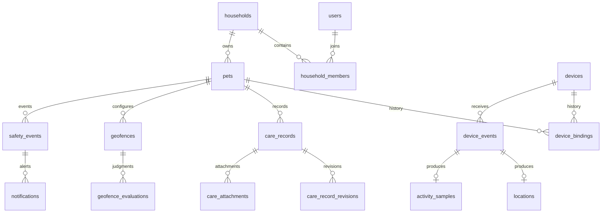

# 数据库存储与维护

## 1. 运行模式和数据位置

| 配置 | 默认位置或连接 | 用途 |
| --- | --- | --- |
| `DB_DRIVER=sqlite` | `DB_PATH=./data/doogy.db` | 单机本地运行，首次启动自动建库 |
| `DB_DRIVER=postgres` | `DATABASE_URL` | PostgreSQL/PostGIS 服务；不读取 SQLite 作为自动回退 |
| 独立演示 | `data/mvp-demo-<随机标识>/doogy.db` | `start-demo.bat` 创建的独立 SQLite/offline 合成数据 |

`DATA_MODE=offline/api` 与数据库选择独立，两种数据库都支持两种数据模式。一次启动选一个数据库，API 和 Worker 使用同一配置；两种数据库不会自动双写或互相同步。

本交付本地 API 默认使用 `3010`，PostgreSQL 示例 API 使用 `3012`。独立 Compose 项目名为 `doggy-clean`，PostgreSQL 监听 `127.0.0.1:55433`；容器内端口仍为 `5432`。数据位于该 Compose 项目的命名卷中，不在源码目录中。

## 2. 模型与迁移

当前模型有 **41 张业务表**，另有 `migrations` 管理表。SQLite 最新迁移为 `021-care-attachments.sql`，PostgreSQL 为 `010-care-attachments.sql`。PostGIS 的 `spatial_ref_sys` 等扩展对象不计为业务表。

`start.bat` 先编译最新源码，再准备所选数据库，按文件名顺序应用尚未执行的迁移。SQLite 从 `db/*.sql` 加载，PostgreSQL 从 `db/postgres/*.sql` 加载。旧业务库是否最新应以它自己的 `migrations` 表为准；启动旧库前先备份。

SQLite 使用 WAL 和本地 TypeScript 围栏几何计算。PostgreSQL 使用 PostGIS 的空间列、GiST 索引和空间距离/包含运算。两者共享业务接口；JSON 载荷主要保存在 `*_json` 文本列，并非统一使用 JSONB。不要删除迁移文件或仅复制最后一份 SQL。

## 3. 全部业务表

| 模块 | 表 |
| --- | --- |
| 用户、家庭、宠物（9） | `users`、`households`、`household_members`、`pets`、`sessions`、`household_invitations`、`auth_attempts`、`household_settings`、`pet_settings` |
| 设备、绑定、指令（7） | `devices`、`device_bindings`、`device_state`、`device_events`、`reporting_policies`、`device_commands`、`lost_mode_sessions` |
| 定位、围栏、安全（6） | `locations`、`geofences`、`geofence_states`、`geofence_evaluations`、`safety_events`、`safety_acknowledgements` |
| 活动与行为（5） | `activity_samples`、`activity_versions`、`daily_summaries`、`activity_observations`、`behavior_feedback` |
| 照护（3） | `care_records`、`care_record_revisions`、`care_attachments` |
| 通知（3） | `notification_preferences`、`push_tokens`、`notifications` |
| 客服、共享（3） | `support_tickets`、`support_ticket_history`、`location_shares` |
| 运维、生命周期（5） | `audit_logs`、`idempotency_keys`、`household_retention`、`privacy_deletions`、`inventory_retention` |

核心关系：



设备和宠物各自最多一条当前有效绑定，历史绑定保留。`device_events.binding_id` 是接收时的绑定快照，由代码核对，不是数据库外键。`device_state` 的最新位置等指针也由业务代码维护。

## 4. 模块数据怎样传输

```text
Web 页面 → 同源 HTTP /api/v1 → Service → 所选数据库 → JSON/文件响应 → 页面
设备/网关 → HTTP 上报 → device_events → Worker → 设备状态/位置/活动/告警
告警 → notifications → Worker → 离线模拟或外部推送 Webhook
用户调整策略 → device_commands → 设备轮询 → 执行回执 → applied 版本
```

用户手动记录照护直接写业务表；修改保留修订，附件 base64 正文随数据库保存。单附件最大 5 MiB，备份不需要额外复制附件目录。

设备上报先入持久队列，返回 HTTP 202 后由独立 Worker 处理。Worker 空闲或不足一批时约 1 秒再检查；当前不依赖 Redis/Kafka/MQTT。活动样本按日期、时区汇总到 `daily_summaries`，样本修订会使旧汇总失效。

概览是多个模块的聚合读取，没有独立 overview 表。Web 当前通过切换标签、操作后重新请求或手动刷新更新。事件确认和通知已读分别保存，推送状态也不等于已读状态。设备接口细节见 [设备接入合同](device-api.md)。

## 5. 启动 PostgreSQL

在项目根目录执行，保留普通 `.env`：

```powershell
npm.cmd run postgres:up
if (!(Test-Path .env.postgres)) { Copy-Item .env.postgres.example .env.postgres }
.\start.bat .env.postgres
```

仅在 `.env.postgres` 不存在时复制模板；已有文件应直接编辑，避免覆盖自己的连接配置。Compose 的账号、数据库和端口应与 `DATABASE_URL` 一致。改用自己的服务器时，服务需支持 PostGIS，初始化账号需具备创建所需扩展和表的权限。

## 6. 备份与恢复

命令在项目根目录执行，需要已安装依赖并完成 `npm.cmd run build`。

SQLite：

```powershell
npm.cmd run db:backup -- ./data/backups/manual.db
npm.cmd run db:restore -- ./data/backups/manual.db ./data/restored.db
```

备份使用 SQLite 在线备份接口，包含已提交的 WAL 数据。恢复目标必须是不存在的新文件。使用恢复副本时，另建环境文件指向 `./data/restored.db`，再用 `start.bat 该环境文件` 启动；不要覆盖原库。

PostgreSQL：

```powershell
.\start.bat .env.postgres backup ./data/backups/manual.dump
.\start.bat .env.postgres restore ./data/backups/manual.dump doogy_recovery
```

归档和同名 JSON 校验清单需一起保留。恢复只创建不存在的新数据库，拒绝覆盖已有目标。默认 `PG_TOOLS=docker` 使用本项目 Compose 服务中的原生 `pg_dump/pg_restore`；其他服务器可用 `PG_TOOLS=native` 并安装兼容版本的工具。

托管备份可对两种数据库使用：

```powershell
.\start.bat .env backup-plan
.\start.bat .env backup-managed
```

自动托管备份默认关闭。启用 `MANAGED_BACKUP_ENABLED=true` 后由运行中的 Worker 定期触发，成功生成完整包后才轮转同源旧包；已有手工归档不加入此轮转。

历史备份可能包含后来已删除的数据。恢复库先隔离运行，在开放 API/Worker 前，从原库导出最新删除日志并对恢复库重放：

```powershell
.\start.bat .env privacy export-log ./data/latest-deletions.json
.\start.bat .env.recovery privacy replay-log ./data/latest-deletions.json
```

`.env.recovery` 必须指向独立恢复库且设置 `DATA_MODE=offline`。重放后核对保留策略及设备凭证，再决定是否开放。

## 7. SQLite 一次性导入 PostgreSQL

先备份，并让源库应用当前 SQLite 迁移。目标必须是业务表为空的新 PostgreSQL 数据库；导入不会合并已有账号或覆盖目标内容。

```powershell
npm.cmd run build
node --env-file=.env.postgres dist/scripts/migrate-postgres.js ./data/doogy.db
```

源 SQLite 以只读连接打开；目标初始化所需迁移后，在事务中逐表导入并核对行数及内容指纹，失败回滚。兼容已知旧 37/39/40 表和当前 41 表源库；缺少的后续字段或表按兼容规则补空。导入完成后两库仍独立，不会持续同步。

## 8. 只读查看

可在对应数据库客户端执行：

```sql
SELECT name FROM migrations ORDER BY name;
SELECT process_status, COUNT(*) AS total FROM device_events GROUP BY process_status;
SELECT status, COUNT(*) AS total FROM notifications GROUP BY status;
SELECT pet_id, device_id, bound_at FROM device_bindings WHERE unbound_at IS NULL;
```

业务数据、备份、`.env` 与真实令牌不提交 Git。结构变更应同时提供两种数据库的增量迁移，保留已有数据和历史迁移。
